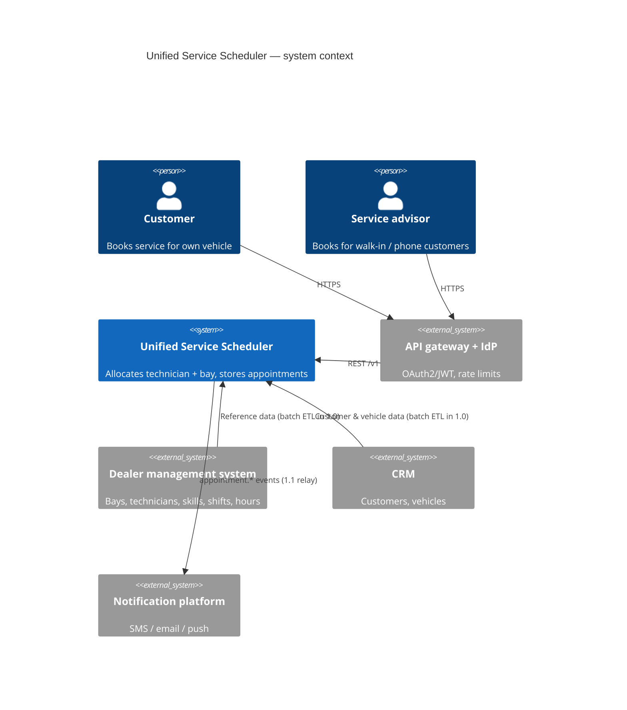
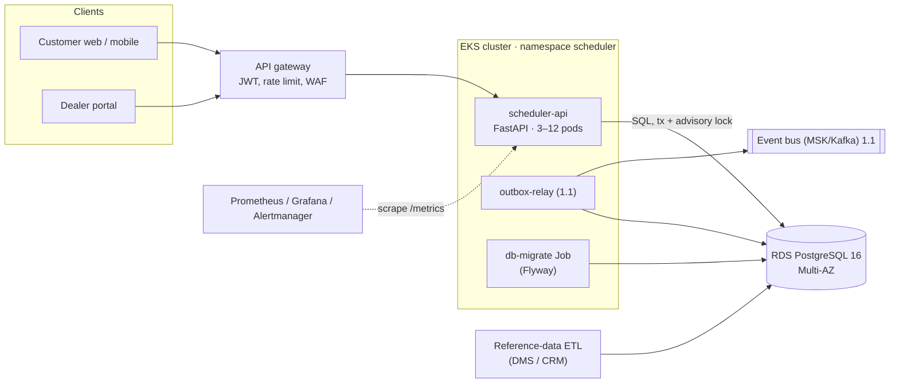

# Architecture Description — Unified Service Scheduler

| Field | Value |
|---|---|
| Document ID | USS-ARC-001 |
| Version | 1.0.0 |
| Status | Superseded by `architecture_v1.1.md` (registry: ECR, ADR-008) |
| Date | 2026-10-15 |
| Requirements baseline | requirements v1.0 |
| Decisions | `adr/index.md` (ADR-001..ADR-006) |

## 1. Architectural drivers

| Driver | Requirement | Architectural response |
|---|---|---|
| Never double-book a technician, bay or vehicle | FR-02, NFR-05 | Decisions made inside one DB transaction under a per-dealership lock; DB exclusion constraints as a backstop (ADR-002) |
| "Real-time" availability | FR-02, NFR-06 | No cache in the decision path; read committed rows inside the booking transaction |
| Two-resource match for the full duration | FR-02 | Pure allocation module over continuous intervals (ADR-003, ADR-005) |
| Reliable record and downstream events | FR-03, FR-10 | Appointment row and outbox row in the same transaction (ADR-004) |
| 99.9 %, p95 ≤ 500 ms at 600 RPS | NFR-01..04 | Stateless API on Kubernetes, HPA 3–12 pods, Multi-AZ PostgreSQL (ADR-006) |
| Safe retries from mobile clients | FR-08 | Mandatory `Idempotency-Key`, unique per customer, stored on the appointment |

## 2. System context (C4 level 1)


Source: `diagrams/c4-context_v1.0.mmd`.

## 3. Containers (C4 level 2)


Source: `diagrams/c4-container_v1.0.mmd`.

| Container | Technology | Responsibility | Requirements |
|---|---|---|---|
| scheduler-api | Python 3.12, FastAPI, psycopg 3 | All use cases; allocation; validation; outbox writes | FR-01..FR-10 |
| PostgreSQL | RDS PostgreSQL 16 + `btree_gist` | Source of truth; exclusion constraints; advisory locks | FR-03, NFR-05, NFR-07 |
| db-migrate | Flyway Job (pre-deploy) | Versioned forward-only migrations `V00N__*.sql` | NFR-11 |
| outbox-relay | (1.1) | Publish outbox rows to the bus, mark them published | FR-10 |
| Reference ETL | Owned by the data team | Load DMS and CRM extracts into reference tables | A-03 |

## 4. Components inside scheduler-api (C4 level 3)

```
app/
├── api/            HTTP adapter: routes, pydantic schemas, problem+json errors
├── services/       SchedulingService: use cases, transactions, booking policy
├── domain/         models, allocation rules, events, ports, errors   ← no framework imports
└── repositories/   memory (dev/test) and postgres adapters implementing domain.ports
```
Layering rule `api → services → domain ← repositories` is enforced in CI by import-linter
(`pyproject.toml`, contract "Domain stays framework-free").

## 5. Key runtime scenario: booking (FR-01/02/03)

1. The gateway authenticates and forwards `POST /v1/appointments` with the `Idempotency-Key`.
2. The service validates references (dealership, service type, customer, vehicle ownership).
3. **`pg_advisory_xact_lock(dealership)`** serialises decisions for that dealership only.
4. Idempotency lookup: a replay returns the stored appointment.
5. Time rules (alignment, lead time, horizon, opening hours) and the vehicle-overlap check run.
6. The service loads the dealership's confirmed appointments for that local day, plus technicians and bays.
7. `allocation.choose()` picks the least-loaded qualified technician and the best-fit compatible bay that are both free for `[start, end)`. If none exists, it computes alternatives and returns 409.
8. INSERT the appointment (exclusion constraints re-check overlaps) and INSERT the outbox event, then COMMIT.

Full sequence diagrams are in `04-design/sequences/`.

## 6. Deployment view

| Concern | Choice |
|---|---|
| Region | AWS ap-south-1, 3 AZs (A-14) |
| Compute | EKS; Deployment `scheduler-api` with topology spread across AZs, PDB minAvailable 2, HPA 3–12 on CPU 60 % |
| Data | RDS PostgreSQL 16 Multi-AZ, PITR (5-min RPO), 35-day snapshots, encrypted with KMS |
| Secrets | AWS Secrets Manager through External Secrets Operator |
| Ingress | AWS ALB through the gateway; TLS 1.2+; NetworkPolicy restricts egress to the DB and DNS |
| Release | GitHub Actions → GHCR image (signed, SBOM) → Kustomize → staging → Argo Rollouts canary in production (ADR-006) |

Manifests: `deploy/k8s/`. Infrastructure: `deploy/terraform/`.

## 7. Cross-cutting concerns

| Concern | Approach | NFR |
|---|---|---|
| Security | Gateway JWT; service trusts only the gateway (NetworkPolicy); not-owner reads as 404; non-root, read-only container; least-privilege DB role (`scheduler_app`: DML only) | NFR-08 |
| Privacy | Minimal PII (A-18); no PII in logs (only IDs); retention job (A-19) | NFR-09 |
| Observability | JSON logs with `request_id`; RED metrics and business counters; alerts → runbook | NFR-10 |
| Time | UTC storage; IANA zone per dealership; `tzdata` shipped in the image | NFR-14 |
| Configuration | 12-factor environment variables (`app/config.py`); booking policy values are config, not code | A-05..A-07 |

## 8. Scalability and evolution
- Per-dealership locks make dealerships independent, so throughput scales with the number of dealerships, not with global contention (capacity estimate §4).
- If one PostgreSQL primary ever becomes the limit (≫ 3,000 dealerships), shard by `dealership_id`. Every query already filters by it.
- 1.1: outbox relay, resource blocks (FR-12) as an extra "busy interval" source to `allocation`, reschedule (FR-11) as cancel plus book in one transaction.

## Revision history

| Version | Date | Author | Change |
|---|---|---|---|
| 1.0.0 | 2026-10-15 | Claude Code | Initial architecture. |
