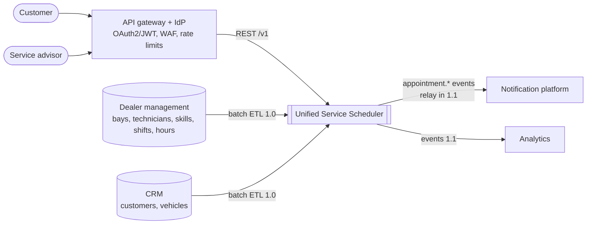
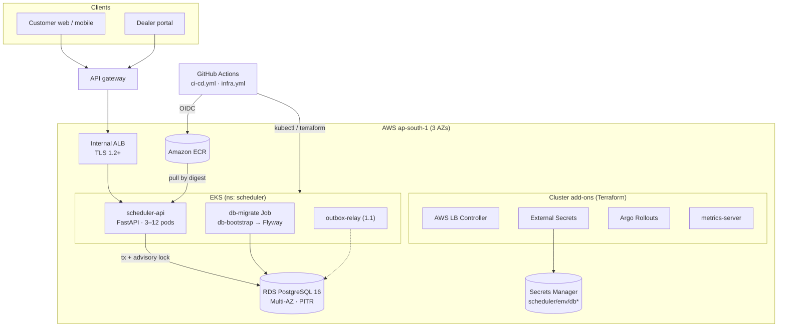
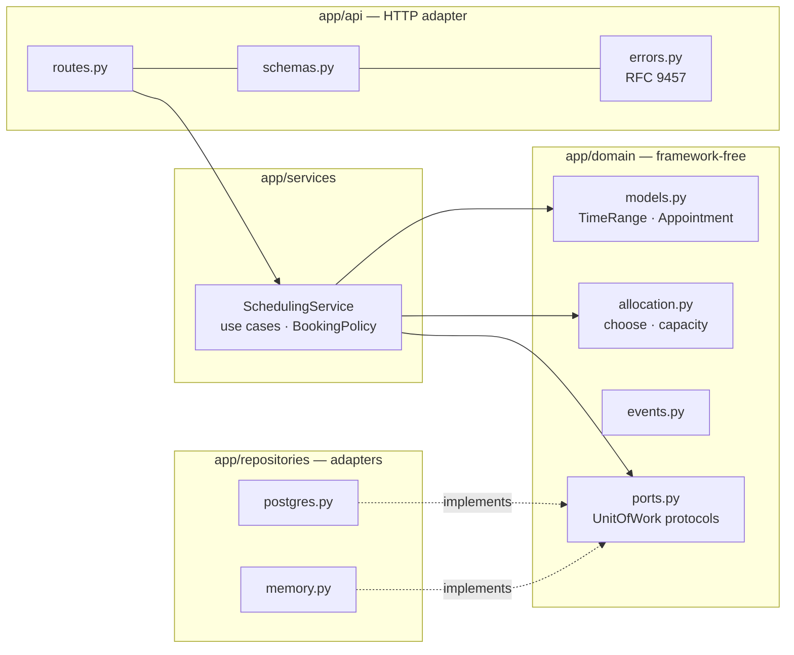
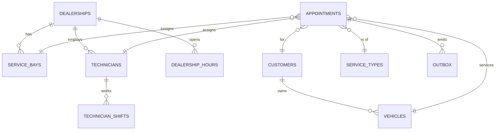
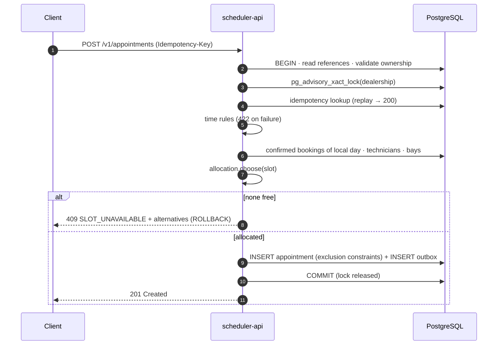
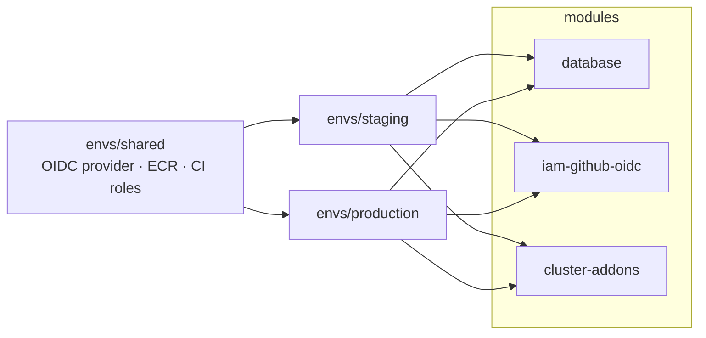
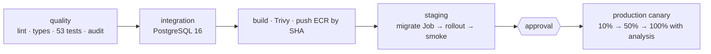
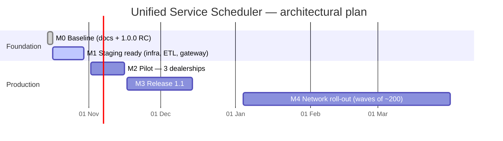

# System Design Document — Unified Service Scheduler

| Field | Value |
|---|---|
| Document ID | USS-SDD-001 |
| Version | 1.0.0 |
| Status | Draft for architecture review |
| Date | 2026-10-17 |
| Applies to | System release 1.0.0 (RC), scheduler-service 1.0.0, API contract 1.0.0, schema V001, deploy 1.1.0 |
| Inputs | `01-requirements/*_v1.0.md`, `architecture_v1.1.md`, ADR-001..ADR-008, `04-design/*`, `02-planning/roadmap_v1.0.md` |
| Author | Claude Code (AI-generated; human review pending — see README "AI Collaboration Narrative") |

This document is the **single end-to-end view** of the system: what it must do, how it is built,
how it runs, and how the architecture evolves. It summarises and links to the detailed sources
rather than repeating them. Where this document and a source differ, the source is authoritative
and this document is wrong. Raise a change request.

---

## 1. Introduction

### 1.1 Purpose
The goal is to replace manual service booking at dealerships (phone calls, spreadsheets, diaries)
with one scheduler. It confirms an appointment **only when a qualified technician and a compatible
service bay are both free for the entire service duration**, and it stores a persistent record
linking the customer, vehicle, technician and bay.

### 1.2 Scope

| In scope (1.0) | Out of scope (1.0) |
|---|---|
| Booking API with automatic technician and bay allocation | Payments and deposits |
| Availability search; alternatives on conflict | Parts reservation, job-card execution |
| Retrieval, cancellation, idempotent retries | SMS and email delivery (the notification platform owns it) |
| Domain events written to an outbox | Reference-data master (DMS and CRM own it) |
| Infrastructure, CI/CD and operations for staging and production | Customer-facing UI (web and app teams consume the API) |

### 1.3 Audience
Architecture review board, engineering, SRE, security and privacy, and the product owner.

### 1.4 Definitions
- **Qualified technician:** active, holds the service type's required skill, and on shift for the whole slot.
- **Compatible bay:** active, at the same dealership, with the required capability.
- **Slot:** the half-open interval `[start, start + duration)`.
- Full glossary: `01-requirements/requirements_v1.0.md` §2.

---

## 2. Requirements summary

### 2.1 Functional (`requirements_v1.0.md` §3)

| ID | Requirement | Priority | Design element |
|---|---|---|---|
| FR-01 | Book for vehicle, service type, dealership and desired time | Must | `POST /v1/appointments` |
| FR-02 | Real-time check that a qualified technician **and** a compatible bay are free for the full duration | Must | `allocation.choose()` under a per-dealership lock, plus DB exclusion constraints |
| FR-03 | Persistent confirmed appointment record | Must | `appointments` table |
| FR-04 | Availability query | Should | `GET /v1/availability` |
| FR-05 | Retrieve and list | Must | `GET /v1/appointments[/{id}]` |
| FR-06 | Up to 3 nearest alternatives on conflict | Should | `409.alternatives[]` |
| FR-07 | Cancel and release resources | Should | `POST /v1/appointments/{id}/cancel` |
| FR-08 | Idempotent booking | Must | `Idempotency-Key`, `UNIQUE(customer_id, key)` |
| FR-09 | Validation rules (ownership, 15-min grid, lead time, horizon, hours, vehicle overlap) | Must | `_validate_start`, vehicle exclusion constraint |
| FR-10 | Domain events | Could | Transactional outbox (relay in 1.1) |
| FR-11..14 | Reschedule, resource blocks, technician choice, reference-data admin UI | Won't (1.0) | Roadmap §12 |

### 2.2 Quality attributes (NFRs) that shape the architecture

| ID | Attribute | Target | Primary architectural response |
|---|---|---|---|
| NFR-01 | Availability | 99.9 % / month | Stateless pods across 3 AZs, PDB, Multi-AZ RDS |
| NFR-02 | Latency | Booking p95 ≤ 500 ms; availability p95 ≤ 300 ms; reads p95 ≤ 200 ms | Indexed single-day reads; no remote calls in the request path |
| NFR-03 | Throughput | 50 bookings/s + 550 reads/s for 30 min | HPA 3–12 pods; per-dealership (not global) serialisation |
| NFR-04 | Scalability | 3,000 dealerships with no schema change | `dealership_id` on every hot path, so it can shard later |
| NFR-05 | Integrity | **0** double-bookings | Three layers of defence (§8) |
| NFR-06 | Real-time consistency | 0 staleness in the decision | No cache in the decision path |
| NFR-07 | DR | RPO ≤ 5 min, RTO ≤ 1 h | RDS PITR, snapshots, documented restore |
| NFR-08 | Security | OAuth2 at the gateway, TLS 1.2+, ASVS L2, 0 HIGH/CRIT CVEs | Gateway JWT; OIDC CI; least-privilege DB roles; scans |
| NFR-09 | Privacy | Minimal PII, 3-year retention, data stays in India | ID-only logs; anonymisation job; ap-south-1 |
| NFR-10 | Observability | RED metrics, JSON logs, alerts → runbook | `/metrics`, request IDs, burn-rate alerts |
| NFR-11 | Deployability | Zero downtime; rollback ≤ 10 min | Canary with automated analysis; expand/contract migrations |
| NFR-14 | Time correctness | UTC storage; dealership-zone rules | `zoneinfo`, `timestamptz` |
| NFR-15 | Cost | ≤ USD 2,500 / month at design load | One service, one database (ADR-001) |

### 2.3 Key assumptions and constraints
Full list: `assumptions_v1.0.md`. The ones that most affect the design:

| Assumption | Statement |
|---|---|
| A-02 | 1,200 dealerships, ≈ 48k appointments/day |
| A-03 | Reference data is replicated from DMS and CRM |
| A-04 | Authentication happens at the gateway |
| A-05 | 15-min grid |
| A-06 / A-07 | Lead time ≥ 60 min; horizon ≤ 90 days |
| A-08 / A-09 | Fixed duration; one technician and one bay per job |
| A-10 | UTC storage |
| A-11 | The system chooses the resources |
| A-14 | Single region, ap-south-1 |

Constraints: C-01 one-time cut-over import; C-02 India data residency; C-03 existing gateway and IdP;
C-04 approval-gated production changes.

---

## 3. Capacity and scale (`capacity-estimation_v1.0.md`)

| Quantity | Year 1 | Design target (≈ 10× peak) |
|---|---|---|
| Appointments per day | ≈ 48,000 | — |
| Peak bookings per second | ≈ 4.6 | **50** |
| Total RPS (≈ 10:1 read:write) | ≈ 60 | **600** |
| Storage, appointments | ~24 GB | ~72 GB over 3-year retention |
| Lock utilisation at the busiest dealership | — | **0.2 %** (per-dealership lock), against 50 % if the lock were global |

**Design consequence:** the risk is *correctness under concurrency*, not volume. A single PostgreSQL
primary and 4–12 small stateless pods meet the targets with headroom. A local baseline gave booking
p95 = 2.8 ms and availability p95 = 2.5 ms (`releases/v1.0.0/test-evidence.md`). That is not a load
test; the staging load test is still required (M1).

---

## 4. Architecture overview

### 4.1 Architectural style
A **modular, single-deployable service** with hexagonal (ports-and-adapters) layering, owning its own
PostgreSQL database (ADR-001). Integration with other systems is asynchronous through a transactional
outbox (ADR-004). The service is stateless and horizontally scaled on Kubernetes (ADR-006).

### 4.2 System context

### 4.3 Containers and runtime topology

| Container | Technology | Responsibility | Source |
|---|---|---|---|
| scheduler-api | Python 3.12, FastAPI, psycopg 3 | All use cases, allocation, validation, outbox writes | `services/scheduler-service/` |
| PostgreSQL | RDS PostgreSQL 16 with `btree_gist` | System of record; exclusion constraints; advisory locks | `migrations/V001__init_schema.sql` |
| db-migrate Job | postgres (psql) + Flyway | Idempotent role bootstrap, then forward-only migrations, before each rollout | `deploy/k8s/base/job-migrate.yaml` |
| outbox-relay | (1.1) | Publish outbox rows, mark them published | ADR-004 |
| Reference ETL | Data team | Load DMS and CRM extracts into reference tables | A-03 |

---

## 5. Component design (scheduler-service)

| Layer | Rule | Enforced by |
|---|---|---|
| `domain` | Imports nothing from FastAPI, Pydantic, psycopg, `api`, `repositories` or `services` | import-linter contract in CI |
| `services` | One transaction per use case through `UnitOfWork`; every booking decision runs after `lock_dealership()` | Code review rule (`CLAUDE.md` §3); tests |
| `repositories` | Map DB errors to domain errors (exclusion violation → `SlotUnavailable`) | Integration tests |
| `api` | Validation, status codes, problem+json; never chooses resources | Contract tests |

Configuration is 12-factor (`APP_*`). Booking-policy values (grid, lead time, horizon, number of
alternatives) are config, not code (`app/config.py`).

---

## 6. Data design (`04-design/data-model/data-model_v1.0.md`)

| Aspect | Design |
|---|---|
| Ownership | `appointments` and `outbox` are owned. Reference tables are read-only replicas (A-03) |
| Time | `timestamptz` half-open `[start_at, end_at)`, stored in UTC |
| Integrity | GiST exclusion constraints on technician, bay and vehicle with `WHERE status='CONFIRMED'`; `UNIQUE(customer_id, idempotency_key)`; FKs everywhere |
| Hot indexes | `(dealership_id, start_at) WHERE CONFIRMED` for day load and availability; `(customer_id, start_at DESC)` for history |
| Concurrency on update | `version` column (optimistic lock) for cancellation |
| Lifecycle | Appointments anonymised after 3 years (A-19); outbox purged 7 days after publish |
| Migrations | Flyway `V<NNN>`, forward-only, expand/contract (`VERSIONING.md` §5) |

**State machine (1.0):** `CONFIRMED → CANCELLED` (only before the start). 1.1 adds reschedule
(FR-11) as cancel plus book in one transaction.

---

## 7. Interface design

### 7.1 REST API (`04-design/api/scheduler-service/v1/openapi_1.0.0.yaml`)

| Operation | Method and path | Success | Key errors |
|---|---|---|---|
| bookAppointment | `POST /v1/appointments` (requires `Idempotency-Key`) | 201 + `Location`; 200 + `Idempotent-Replayed` on replay | 409 `SLOT_UNAVAILABLE` (+ `alternatives`), `VEHICLE_ALREADY_BOOKED`, `IDEMPOTENCY_KEY_REUSED`; 422 `UNKNOWN_*`, `VEHICLE_NOT_OWNED_BY_CUSTOMER`, time-rule codes; 400 `IDEMPOTENCY_KEY_REQUIRED` |
| getAppointment | `GET /v1/appointments/{id}` | 200 | 404 (also for another customer's ID) |
| listAppointments | `GET /v1/appointments?customer_id=` | 200 | 422 |
| cancelAppointment | `POST /v1/appointments/{id}/cancel` | 200 (idempotent) | 404; 409 `CANCELLATION_WINDOW_CLOSED`, `CONCURRENT_MODIFICATION` |
| getAvailability | `GET /v1/availability?dealership_id&service_type_id&date` | 200 slots with capacity (advisory) | 422 |
| Reference data | `GET /v1/dealerships`, `GET /v1/service-types` | 200 | — |
| Health | `GET /health/live`, `GET /health/ready` | 200 / 503 | — |

**Conventions:**
- Errors are RFC 9457 problem+json with a stable `code`.
- Appointment times are returned in UTC; availability slots use the dealership's local offset.
- The client cannot name a technician or bay; extra fields are rejected.
- Versioning uses a URL major version plus a SemVer document, with deprecation headers for at least 6 months.

### 7.2 Events (`04-design/events/`)
`appointment.confirmed` v1 and `appointment.cancelled` v1 go to topic `scheduler.appointments.v1`,
keyed by `aggregate_id`. Delivery is at-least-once, so consumers deduplicate on the envelope `id`.
Additive changes stay in the same version; breaking changes get a new version, dual-published for 90 days.

---

## 8. Core design: availability, allocation and concurrency

### 8.1 Allocation algorithm (ADR-003, ADR-005)
For a requested slot `S = [t, t + duration)` at dealership `D`:

1. **Validate** (FR-09):
   - the start is on the 15-min local grid;
   - `now + 60 min ≤ t ≤ now + 90 d`;
   - `S` is inside the opening hours of `D`;
   - the vehicle has no overlapping confirmed appointment.
2. **Load** the confirmed appointments of `D` for the local day containing `t`, plus the technicians (with shifts) and bays of `D`.
3. **Free technicians:** active, have `required_skill`, their shift contains `S`, and no booking overlapping `S`.
4. **Free bays:** active, have `required_bay_capability`, and no booking overlapping `S`.
5. If either set is empty → **409**, with the ≤ 3 nearest bookable starts found within 7 days (FR-06).
6. **Choose** deterministically:
   - the technician with the fewest minutes booked that day, ties broken by ID;
   - the bay with the fewest capabilities (best fit, which keeps specialised bays free), ties broken by ID.

**Capacity** for availability is `min(|free technicians|, |free bays|)`. This is exact because any
qualified technician can work in any compatible bay. Cost per decision is at most 40 candidates × 18
resources × 40 bookings, about 30k comparisons, which takes under 5 ms of CPU.

### 8.2 Concurrency control: three layers of defence (ADR-002)

| Layer | Mechanism | What it protects against |
|---|---|---|
| 1. Serialisation | `pg_advisory_xact_lock(hash('dealership:'+id))` taken **before** reading schedules, released at commit | Two requests at one dealership interleaving read-check-insert |
| 2. Database invariant | GiST `EXCLUDE (technician_id WITH =, tstzrange WITH &&)`, and the same for bay and vehicle, `WHERE CONFIRMED` | Any code path, script or bug that bypasses layer 1 |
| 3. Idempotency | Lookup after the lock; `UNIQUE(customer_id, idempotency_key)`; request fingerprint | Client retries creating duplicates |

A layer-2 violation is mapped to `409`. It also logs `EXCLUSION_BACKSTOP`, which pages on-call
(runbook RB-04), because it means layer 1 failed.

### 8.3 Booking sequence (`04-design/sequences/book-appointment_v1.0.mmd`)

---

## 9. Non-functional design

### 9.1 Scalability and performance
- **Stateless API:** HPA 3–12 pods at 60 % CPU, about 150 RPS per pod, so 4 pods cover 600 RPS. Each pod's DB pool is 10, giving at most 120 connections.
- **Contention:** the per-dealership lock means throughput grows with the number of dealerships.
- **Growth beyond about 3,000 dealerships:** shard by `dealership_id`, since every query already filters on it. Partitioning `appointments` by month is an option for 2.0.
- **No cache in the decision path (NFR-06).** Availability may be cached later at the edge, but only as an advisory value.

### 9.2 Availability and resilience

| Failure | Behaviour |
|---|---|
| Pod or node loss | Kubernetes reschedules; the PDB keeps ≥ 2 pods; topology spread keeps ≥ 1 pod per AZ |
| AZ loss | RDS Multi-AZ failover (60–120 s); the pool reconnects; readiness gates traffic |
| Bad release | Argo Rollouts canary 10 % → 50 % → 100 % with automatic abort on 5xx rate or p95 |
| DB unreachable | `/health/ready` reports 503, pods are taken out of rotation, and RB-05 applies |
| Region loss | Restore a cross-region snapshot (accepted RPO 24 h for 1.0; revisit at M4) |

### 9.3 Security (NFR-08)

| Control | Implementation |
|---|---|
| Authentication | Gateway validates the JWT and enforces that `customer_id` = `sub`, or the advisor role is in scope (A-04) |
| Authorisation | Another customer's appointment returns 404 (no ID probing) |
| Network | Internal ALB; NetworkPolicy (ingress controller and monitoring in; DB and DNS out); DB security group only from EKS nodes |
| Secrets | Generated by Terraform and stored in Secrets Manager (KMS). External Secrets syncs 3 split secrets: app (DML), migrate (DDL), bootstrap (admin) |
| Database roles | `scheduler_app` can SELECT, INSERT and UPDATE only. Verified: no DELETE and no DDL |
| CI/CD | GitHub OIDC with no stored AWS keys; ECR immutable tags with scan on push; Trivy fails the build on HIGH/CRIT; pip-audit; deploy by digest |
| Runtime | Non-root UID 10001; read-only root FS; dropped capabilities; seccomp; restricted Pod Security |

### 9.4 Privacy (NFR-09)
Only `display_name`, VIN and IDs are stored; logs carry IDs only; appointments are anonymised after 3 years;
all data stays in ap-south-1.

### 9.5 Observability (NFR-10, `05-operations/`)
- **Metrics:** RED metrics per templated route, plus the business counters `scheduler_appointments_confirmed_total` and `scheduler_booking_rejections_total{code}`.
- **Logs:** JSON with `X-Request-ID` correlation.
- **SLOs:** booking 99.9 %, availability 99.5 %, reads 99.9 %, with multi-window burn-rate alerts. Every alert links to a runbook (RB-01..06).
- **1.1:** OpenTelemetry tracing and an outbox-backlog gauge.

### 9.6 Disaster recovery (NFR-07)
PITR with 35-day retention (RPO ≤ 5 min) and a documented restore to a new instance with a secret
endpoint swap (RTO ≤ 1 h). Drills run quarterly (`maintenance_v1.0.md`).

---

## 10. Deployment architecture

### 10.1 Environments

| Environment | Purpose | Database | Namespace | Gate |
|---|---|---|---|---|
| Local | Development and automated tests | Compose PostgreSQL or in-memory | — | `make verify`, `make docker-test` |
| Staging | Integration, smoke, load | db.t4g.medium, single-AZ, 7-day PITR | `scheduler-staging` | Automatic on `main` |
| Production | Live | db.r6g.large, Multi-AZ, 35-day PITR, deletion protection | `scheduler` | Required reviewers + canary analysis |

### 10.2 Infrastructure as code (ADR-007, `deploy/terraform/`)

The pipeline applies the stacks in order, shared → staging → production, through `infra.yml`.
Every PR gets a plan comment; each apply waits for its approval gate. Only these steps stay manual:
- the state bucket;
- the first apply of `envs/shared`;
- GitHub settings;
- DNS and the gateway.

The full checklist is in `deploy/README.md` under "Day 0 bootstrap".

### 10.3 Delivery pipeline (`ci-cd.yml`)

**Rollback** (≤ 10 min) is `kubectl argo rollouts undo`. The schema is never rolled back:
migrations are expand/contract, so the previous image always runs on the current schema.

---

## 11. Key decisions and trade-offs (ADR summary)

| ADR | Decision | Main trade-off accepted |
|---|---|---|
| 001 | One service owning its own PostgreSQL | Must split later if teams or scale demand it; seams are the `domain.ports` |
| 002 | Per-dealership advisory lock plus exclusion constraints | Requires `btree_gist`; decisions at one dealership are serial (0.2 % utilisation) |
| 003 | System allocates: least-loaded technician, best-fit bay | No customer choice of technician in 1.0 |
| 004 | Transactional outbox | Events are delayed until the 1.1 relay; consumers must deduplicate |
| 005 | Continuous intervals on a 15-min grid; no slot table | No overnight windows (A-09) |
| 006 | EKS + RDS, GitHub Actions, Argo Rollouts canary | Kubernetes operational overhead versus simpler PaaS |
| 007 | Day-0 infrastructure in Terraform, including add-ons and DB bootstrap | Generated passwords in Terraform state, so state must be locked down |
| 008 | Amazon ECR as the registry (replaces GHCR) | AWS-coupled registry; semver tags need a release workflow |

---

## 12. Architectural plan (evolution roadmap)

### 12.1 Milestones (`02-planning/roadmap_v1.0.md`)

### 12.2 Architecture by phase

| Phase | Architectural change | Trigger or exit criterion | Requirements |
|---|---|---|---|
| **1.0 (M0–M2)** | Single service + RDS; outbox written but not relayed; batch reference ETL; canary deploys | Pilot: 2 weeks, 0 double-bookings, SLO met | FR-01..10, NFR-01..15 |
| **1.1 (M3)** | **Outbox relay** → MSK topic `scheduler.appointments.v1` → notifications; **resource blocks** (leave, maintenance) as extra busy intervals fed to `allocation`; **reschedule** as cancel + book in one transaction; OpenTelemetry; outbox-backlog alert; event-driven reference-data sync | CR approval; API contract 1.1.0 (additive) | FR-10, FR-11, FR-12 |
| **Cut-over (M4)** | One-time import of future manual bookings, run through the same allocation and constraints (conflicts are reported, never forced); per-wave rollout | G-5: no dealership on spreadsheets or diaries | C-01, BR-04 |
| **2.0 (candidate)** | Customer-chosen technician (preference weighting in `choose()`); multi-technician jobs (allocation over resource sets); regional DR (warm standby in ap-south-2) | Business case; region-loss RPO target | FR-13, NFR-07 |
| **Scale-out (as needed)** | Monthly partitioning of `appointments`; shard by `dealership_id` beyond about 3,000 dealerships or when a single primary exceeds 60 % CPU | Capacity review each quarter | NFR-04 |

### 12.3 Migration and cut-over strategy
1. **Pilot in parallel** (M2): advisors book in the scheduler and keep the diary as a fallback. A daily reconciliation report lists any differences.
2. **Import:** for each wave, export future manual bookings, then import them through the API (the same validation and allocation). Conflicts go to advisors to resolve.
3. **Switch:** the diary becomes read-only, then is retired for that wave. A rollback window of one week applies per wave.

---

## 13. Risks and mitigations (`02-planning/raid-log.md`)

| Risk | Impact | Architectural mitigation | Status |
|---|---|---|---|
| R-01 Race leads to double-booking | High | Three layers (§8.2); concurrency tests on PostgreSQL | Mitigated |
| R-02 Bad DMS/CRM reference data | High | Data-quality report (M-02); SLOT_UNAVAILABLE ratio alert (RB-03); pilot first | Open |
| R-03 Dual sources of truth during cut-over | High | Parallel pilot, reconciliation, per-wave retirement | Open |
| R-04 Time zone or DST bugs | Med | UTC + IANA; `tzdata` updates monthly | Mitigated |
| R-05 Fixed durations overrun | Med | Track actual vs planned (1.1); per-type buffer option | Open |
| R-06 No notifications in 1.0 | Low | In-app confirmation; relay in 1.1 | Accepted |
| R-07 AI-generated defects | High | Layered verification, human review gate | Open |
| New: Terraform state holds passwords | Med | Encrypted, versioned, access-limited state bucket; rotation procedure | Mitigated by design |

---

## 14. Open issues

| # | Issue | Owner | Needed by |
|---|---|---|---|
| 1 | Requirements and assumption sign-off (A-01..A-19) | Product owner | M1 |
| 2 | Retention period confirmation (A-19 / Q-05) | Legal | Go-live |
| 3 | Load test, restore drill, rollback drill, pen test | QA / SRE / Security | M2 |
| 4 | Permissions boundary for `uss-terraform-apply` | Platform security | M1 |
| 5 | Release workflow for semver image tags in ECR | Engineering | M3 |
| 6 | Whether the platform team or this repo owns the cluster add-ons on shared clusters (`install_*` toggles) | Platform | M1 |

---

## 15. Traceability
Forward and backward traces: `01-requirements/traceability-matrix_v1.1.csv` (`.md` for reading).
Every in-scope FR maps to an ADR, an endpoint or table, code, and at least one `test_fr_xx_*` test.
Every NFR maps to a design element and to its verification, or is marked pending.

## Revision history

| Version | Date | Author | Change |
|---|---|---|---|
| 1.0.0 | 2026-10-17 | Claude Code | Initial consolidated system design document with architectural plan. |
