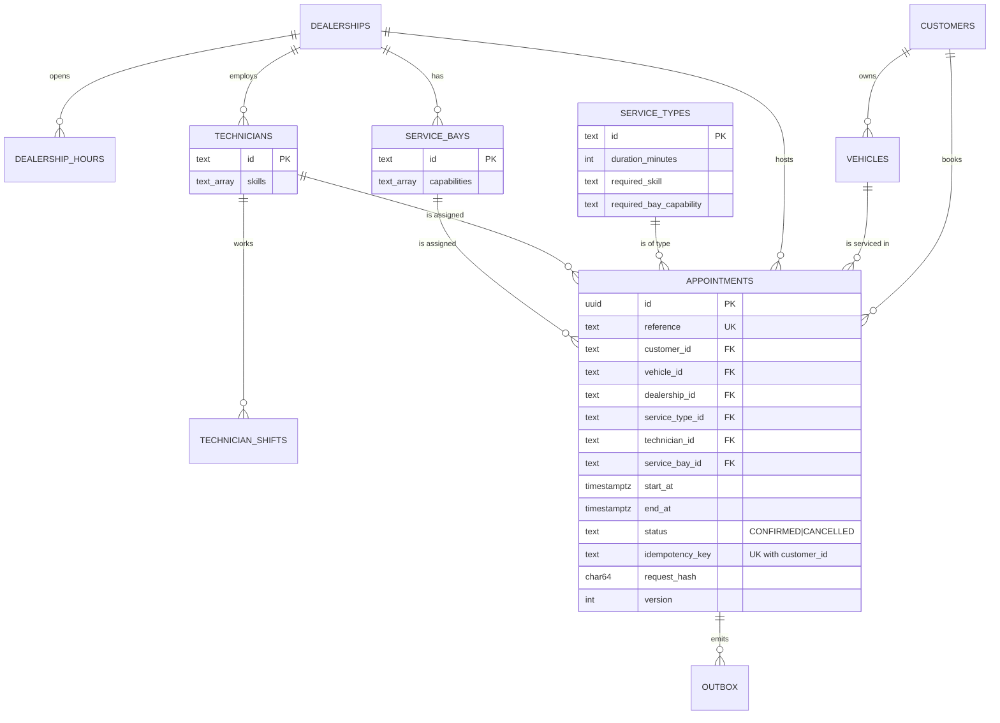
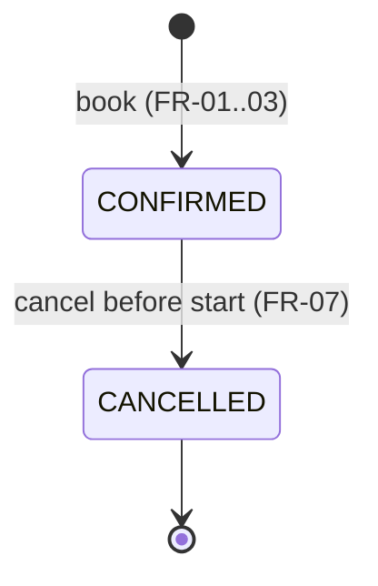

# Data Model — scheduler-service

| Field | Value |
|---|---|
| Document ID | USS-DAT-001 |
| Version | 1.0.0 (schema `V001`) |
| Status | Baselined |
| Date | 2026-10-15 |
| DDL | `services/scheduler-service/migrations/V001__init_schema.sql` |

## 1. Entity-relationship diagram

## 2. Tables

**Ownership.** Reference tables are **replicas**, loaded by the ETL from DMS and CRM (A-03).
`appointments` and `outbox` are **owned** by this service.

| Table | Purpose | Key columns and rules | Indexes / constraints |
|---|---|---|---|
| `dealerships` | Dealership and its IANA time zone | `timezone` (e.g. `Asia/Kolkata`), `active` | PK `id` |
| `dealership_hours` | Weekly opening hours | `weekday` 1–7 (ISO), `opens_at < closes_at` | PK `(dealership_id, weekday)` |
| `service_types` | Catalogue of jobs | `duration_minutes` 15–600; `required_skill`; `required_bay_capability` | PK `id` |
| `service_bays` | Physical bays | `capabilities text[]` | PK, `ix_service_bays_dealership` |
| `technicians` | Technicians | `skills text[]` | PK, `ix_technicians_dealership` |
| `technician_shifts` | Weekly shift template | `starts_at < ends_at` | PK `(technician_id, weekday)` |
| `customers` | Minimal customer replica | `display_name` only (A-18) | PK |
| `vehicles` | Vehicle replica | `vin char(17)` unique; `customer_id` = registered owner | PK, UK `vin`, `ix_vehicles_customer` |
| `appointments` | **Confirmed booking record (FR-03)** | half-open `[start_at, end_at)`; `status`; `version` (optimistic lock for cancel) | see §3 |
| `outbox` | Pending domain events (ADR-004) | `payload jsonb`, `published_at` null until relayed | `ix_outbox_unpublished` (partial) |

## 3. `appointments` integrity rules

| Rule | Mechanism | Requirement |
|---|---|---|
| End after start | `CHECK (end_at > start_at)` | FR-03 |
| No technician overlap among CONFIRMED rows | `EXCLUDE USING gist (technician_id WITH =, tstzrange(start_at,end_at,'[)') WITH &&) WHERE status='CONFIRMED'` | FR-02, NFR-05 |
| No bay overlap | same, on `service_bay_id` | FR-02, NFR-05 |
| No vehicle overlap | same, on `vehicle_id` | FR-09(f) |
| One booking per (customer, idempotency key) | `UNIQUE (customer_id, idempotency_key)` | FR-08 |
| Unique human reference | `UNIQUE (reference)` | FR-03 |
| Referential integrity | FKs to every referenced entity | FR-03 |
| Cancelled rows free their resources | the constraint's `WHERE status='CONFIRMED'` | FR-07 |

**Query-serving indexes.**
- `ix_appointments_dealership_start (dealership_id, start_at) WHERE status='CONFIRMED'` serves day-load and availability (FR-02, FR-04).
- `ix_appointments_customer_start (customer_id, start_at DESC)` serves customer history (FR-05).
- The GiST exclusion indexes also serve the vehicle-overlap lookup.

## 4. Domain model (Python, `app/domain/models.py`)

| Type | Kind | Notes |
|---|---|---|
| `TimeRange` | Value object | Half-open; requires timezone-aware datetimes; `overlaps`, `contains` |
| `DailyWindow` | Value object | Local `opens`/`closes`; `.on(date, tz)` returns a `TimeRange` |
| `Dealership`, `ServiceType`, `ServiceBay`, `Technician`, `Customer`, `Vehicle` | Entities (read-only) | Frozen dataclasses |
| `Appointment` | Aggregate root | `confirm(...)` factory (normalises to UTC), `cancel(now, reason)` (only CONFIRMED and before start; increments `version`) |
| `AppointmentStatus` | Enum | `CONFIRMED`, `CANCELLED` (1.1 may add `RESCHEDULED`) |

State machine:

## 5. Data lifecycle

| Data | Retention | Mechanism |
|---|---|---|
| appointments | 3 years after `end_at`, then anonymised: `customer_id` and `vehicle_id` are replaced with a tombstone; `notes` and `cancellation_reason` are set to null (A-19) | Monthly maintenance job (`05-operations/maintenance_v1.0.md`) |
| outbox | 7 days after `published_at` | Daily purge job |
| reference data | Mirrors the upstream masters | ETL upserts; deletes become `active=false` |

## 6. Migration policy
Forward-only Flyway migrations `V<NNN>__<desc>.sql`. A released file is never edited. Breaking
changes follow expand → migrate → contract across two releases (`VERSIONING.md` §5).
`V002__seed_demo_reference_data.sql` is for local and staging only and is excluded in production.

## Revision history

| Version | Date | Author | Change |
|---|---|---|---|
| 1.0.0 | 2026-10-15 | Claude Code | Initial model (schema V001). |
